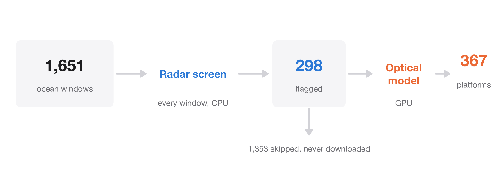
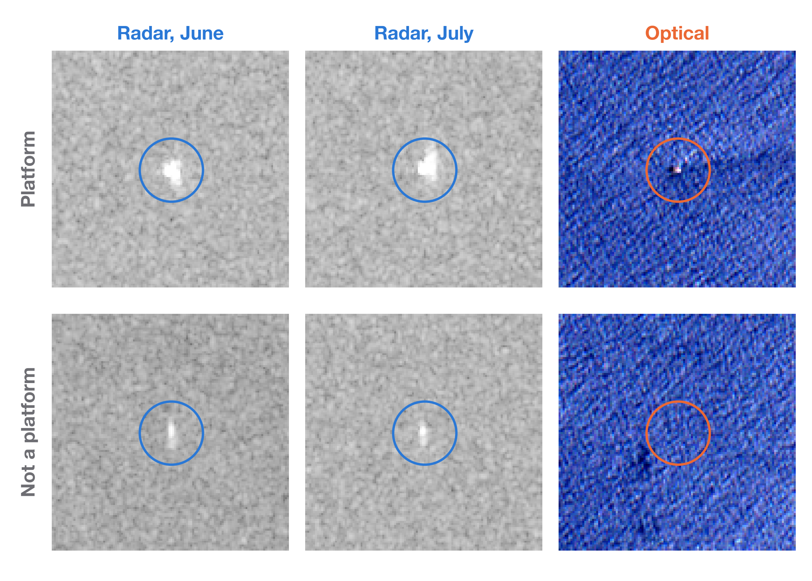
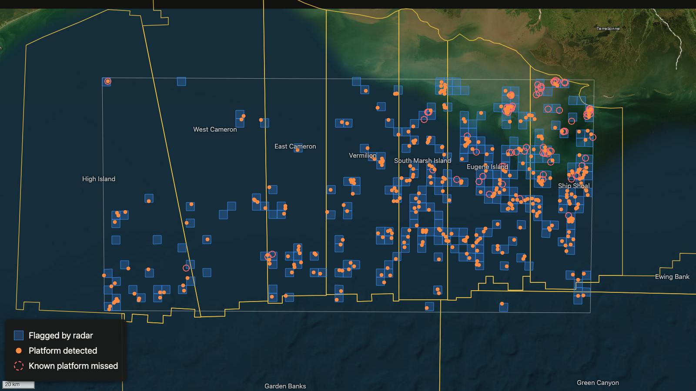
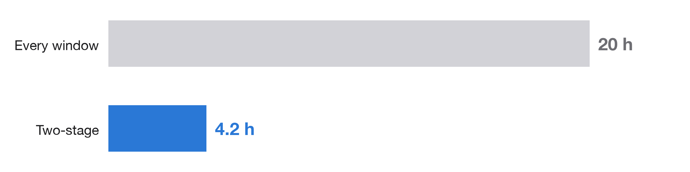
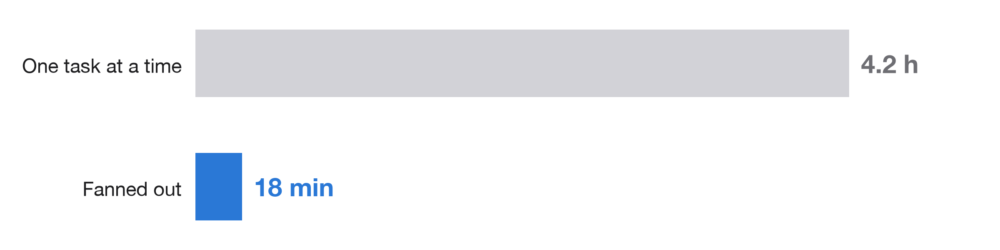
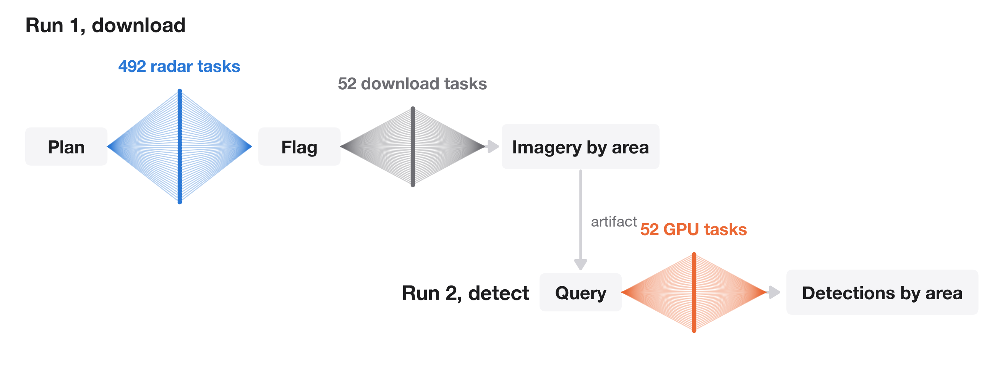

# Finding Every Platform in the Gulf Without Looking Everywhere

This piece sits between a research note and an engineering blog post. The detection methods it uses are published and well understood. The focus is on how to implement them, measure them and run them as a dependable production job, so that the same approach can be reused on another coastline or another kind of object. Code is in [github.com/dansola/satellite-cascade](https://github.com/dansola/satellite-cascade).

The problem is locating offshore oil and gas structures on the Texas and Louisiana shelf from free satellite imagery. An independent, repeatable view of offshore infrastructure is useful well beyond the energy industry. Regulators track structures that should have been removed, insurers and analysts want to know what is standing where, and environmental groups watch for activity that official records miss. The same pipeline also works in waters where no public registry exists. The practical difficulty is cost. Running a modern image model over every square kilometre of a continental shelf, every quarter, is expensive, and almost all of that area is empty water.

## 1. What is already known

The Bureau of Safety and Environmental Enforcement (BSEE) publishes the location of every permitted structure in federal Gulf waters, updated monthly, together with a list of removed structures [3]. Those waters produce about 1.8 million barrels of crude a day, roughly a seventh of US output [1, 2]. A satellite view adds value next to that record by checking it independently, by showing structures that are idle or overdue for removal, which the GAO put at about 500 Gulf platforms in June 2023 [4], and by covering regions with no comparable records.

Detecting platforms from orbit is also well studied. Wong, Thomas and Halpin extracted Gulf platforms from Sentinel-1 radar in Google Earth Engine with a detection rate near 99% [7]. Paolo et al. combined Sentinel-1 and Sentinel-2 with deep learning to map offshore infrastructure and vessel traffic worldwide from 2017 to 2021 [8], and their inventory serves as ground truth here. The Allen Institute for AI publishes a monthly global layer of offshore platforms and wind turbines from Sentinel-2 through its Satlas project, along with model weights [9]. Two 2026 studies extend the radar approach, with Si et al. counting 1,593 Gulf platforms in a six-basin dataset for 2017 to 2023 [10] and Spanier et al. counting 1,641 in a quarterly record that runs to 2025 [11].

A two-stage design, where a cheap test screens everything and an expensive test runs only on what the screen flags, is standard in radar ship detection. A constant false alarm rate (CFAR) detector, descended from Finn and Johnson's 1968 work [5], proposes candidates, and a more expensive discrimination step decides which are real [6].

## 2. What this post adds

The contribution is a worked, reproducible implementation of a two-stage detector that holds up as a production job. A cheap radar screen decides where to look and a published optical model decides what is there. The post measures what that split saves and what it costs in accuracy, then shows how to run it as a distributed pipeline that survives interruptions, records every intermediate result and can be re-run for one named region, a new quarter or a global backfill. Every run in this post, from the pilot onward, executes remotely on [Flyte](https://flyte.org), an open-source orchestrator for distributed Python, and section 8 covers how the pipeline is built on it. The same structure applies to most discovery problems over large areas, where a cheap signal can rule out most of the search space before an expensive model is spent on the rest.

The analysis uses one metric projection, UTM zone 15N, and divides the sea into square windows 5.12 km on a side, which is 512 pixels at Sentinel-2's 10 m resolution. Results are organised by the Bureau of Ocean Energy Management's planning areas and named protraction areas, such as Eugene Island and Ship Shoal [12].


*Figure 1. The two-stage approach on a quarter of the Texas and Louisiana shelf.*

## 3. Data

**Sentinel-1** ([AWS Open Data](https://registry.opendata.aws/sentinel-1/)) is a C-band synthetic aperture radar. It measures backscatter, the energy returned toward the satellite. Smooth water reflects the pulse away and looks dark, while steel structures act as corner reflectors and look bright. Radar sees through cloud and works at night. In interferometric wide swath mode each pass covers a strip roughly 250 km across, and each satellite repeats its track every 12 days. Sentinel-1A launched in 2014, and Sentinel-1C replaced Sentinel-1B at the end of 2024 [15]. This analysis uses ground-range-detected (GRD) scenes in VV polarisation from June to August 2021.

**Sentinel-2** ([AWS Open Data](https://registry.opendata.aws/sentinel-2/)) carries a multispectral camera with thirteen bands from visible light to shortwave infrared, at 10, 20 or 60 m resolution, over a 290 km swath. The satellites launched in 2015, 2017 and 2024 [15]. The analysis uses Level-1C products, the format the optical model was trained on.

**Ground truth** is the offshore infrastructure inventory of Paolo et al. [8], released by Global Fishing Watch under CC BY 4.0, filtered to structures observed in 2021.

Both archives are indexed by [Earth Search](https://element84.com/earth-search/), a public STAC catalogue run by Element 84, and the rest of the work uses the standard Python geospatial stack. [pystac-client](https://pystac-client.readthedocs.io) searches the catalogue, [rasterio](https://rasterio.readthedocs.io) reads imagery through [GDAL](https://gdal.org), [pyproj](https://pyproj4.github.io/pyproj/) converts coordinates and [shapely](https://shapely.readthedocs.io) handles geometry.

```python
# python 3.12
# pip install pystac-client rasterio pyproj shapely numpy scipy torch rslearn==0.1.18
from pystac_client import Client

catalog = Client.open("https://earth-search.aws.element84.com/v1")
s1 = catalog.search(collections=["sentinel-1-grd"], bbox=bbox,
                    datetime="2021-06-01/2021-08-31").item_collection()
s2 = catalog.search(collections=["sentinel-2-l1c"], bbox=bbox,
                    datetime="2021-06-01/2021-09-28").item_collection()
```

The essential trick is the windowed read. GDAL fetches only the byte ranges that cover the requested window, so a 5 km chip comes out of a 100 km tile without downloading the tile.

```python
import rasterio
from rasterio.windows import Window

with rasterio.Env(AWS_NO_SIGN_REQUEST="YES"), rasterio.open(href) as ds:
    chip = ds.read(1, window=Window(col, row, 512, 512))
```

Sentinel-1 GRD files are delivered in radar geometry with ground control points, so pixel positions are converted with `rasterio.transform.GCPTransformer`. Unsigned access is best set for GDAL alone through `rasterio.Env`, which leaves other libraries free to use their own credentials.

## 4. Two detectors

**Radar, two-parameter CFAR with persistence.** CFAR detection began with Finn and Johnson's cell-averaging detector [5], which compares each pixel with the mean of the water around it. The two-parameter form used here, common in SAR ship detection [6], also uses the spread of that background. For a pixel with intensity $x$, let $\mu$ and $\sigma$ be the mean and standard deviation of intensity in a background box of side $B$ around it, excluding a smaller guard box of side $G$ so that the target does not inflate its own background. The pixel is flagged when

$$
x > \mu + k\sigma \quad \text{and} \quad x > r\mu .
$$

The first condition adapts the threshold to the local sea state and the second rejects faint bumps on very calm water. With $B = 61$, $G = 11$, $k = 6$ and $r = 6$, both statistics come from box filters.

```python
import numpy as np
from scipy import ndimage as ndi

def cfar(img, guard=11, bg=61, k=6.0, r=6.0):
    x = img.astype(np.float32) ** 2                      # amplitude to intensity
    box = lambda a, n: ndi.uniform_filter(a, n) * n * n  # sum over an n x n box
    n = bg * bg - guard * guard                          # pixels in the ring
    mu = (box(x, bg) - box(x, guard)) / n
    sigma = np.sqrt(np.maximum((box(x * x, bg) - box(x * x, guard)) / n - mu ** 2, 1e-6))
    return (x > mu + k * sigma) & (x > r * mu)
```

On a single date a ship and a platform look alike. The second step therefore uses time. Detections from every pass are clustered within 80 m with a k-d tree from [SciPy](https://scipy.org), and a cluster becomes a persistent target if it appears on at least three passes and on at least half of the passes that covered it. Ships rarely stay in one place for a summer.

```python
from scipy.spatial import cKDTree
from scipy.sparse.csgraph import connected_components

tree = cKDTree(points)  # (x, y) of every detection from every pass
_, cluster = connected_components(tree.sparse_distance_matrix(tree, 80.0), directed=False)
# persistent if a cluster spans >= 3 passes and >= half of the passes covering it
```

**Optical, Satlas.** The second detector is the marine infrastructure model from the Allen Institute for AI's [Satlas](https://satlas.allen.ai) project [9]. It uses a Swin Transformer backbone [13] and a feature pyramid feeding a Faster R-CNN head [14], trained on Sentinel-2. Its input is four 9-band images of the same window, one from each of four consecutive months, and it returns boxes labelled platform or turbine with a confidence score. The released checkpoint is used as published through Ai2's [rslearn](https://github.com/allenai/rslearn) library, running on [PyTorch](https://pytorch.org).

Figure 2 shows why the two are complementary. A platform is a strong, compact radar return on every date and a visible speck in the optical image. The second row is a radar target that also persists on every date, but is faint and narrow and invisible optically. It is probably a small fixed object such as a buoy, which is not a platform by the inventory's definition, and the optical stage removes it.


*Figure 2. 1.2 km patches seen by radar on two dates and by the optical camera.*

## 5. Testing the two-stage method on a pilot area

Before scaling, the method was tried on a pilot area of 144 windows, about 3,800 km², as a smoke test. The goal was to check that skipping windows did not lose detections and that the optical stage earns its place. With only 15 known structures in the area, the result is a sanity check rather than a measurement. The radar screen flagged 16 windows.

| Pilot, 144 windows | Radar only | Two-stage | Optical model on every window |
|---|---|---|---|
| Known structures found (of 15) | 14 | 14 | 14 |
| Targets reported | 19 | 14 | 14 |
| Precision against the inventory | 74% | 100% | 100% |
| Compute time | 2 min | 14 min | about 2 h |

The two-stage result matches running the optical model everywhere, using about an eighth of the compute because only 11% of the pilot's windows were flagged. Radar alone reaches the same recall in a fraction of the time, and the optical stage is what turns its 19 targets into 14 confirmed platforms, removing all 5 of its false alarms. Compute time is summed across tasks on CPU, and the every-window figure is estimated from measured per-window cost. About 80% of the two-stage time is spent downloading Sentinel-2 imagery, roughly 42 s per window, which is the main cost the radar screen avoids.

## 6. Results on a quarter of the shelf

The scaled run covered 27.9° to 29.1° N and 94° to 91° W with land removed, 1,651 ocean windows across ten protraction areas. For this run the optical stage moved from CPU to an NVIDIA L4 GPU. In Flyte that is a change to the task's image and resource request (section 8), and the GPU runs the model about two hundred times faster per window (section 7). Pilot times above are on CPU, and quarter-shelf times are on GPU.

The radar screen flagged 298 windows, 18% of the area, including 264 of the 265 windows that contain a known structure. The optical model found 367 of 449 known structures (82%), and 99% of its detections matched the inventory within 100 m. The 264 of 265 is window-level recall, whether a window holding a structure was flagged. Published satellite work on the Gulf [7, 10, 11] reports structure-level figures from different methods and periods, so it gives context rather than a direct comparison. Structure-level recall here is set by the optical stage.

| Quarter shelf, 1,651 windows | Two-stage |
|---|---|
| Windows sent to the optical model | 298 |
| Known structures found (of 449) | 367 (82%) |
| Targets reported | 371 |
| Precision against the inventory | 99% |
| Compute time | 4.2 h |


*Figure 3. Flagged windows, detected platforms and missed known platforms, with BOEM protraction areas outlined.*

The map shows where that happens. Misses cluster near the coast in inshore Ship Shoal and Eugene Island, closer to the Mississippi outflow. Ship Shoal recovers 87 of 132 known structures, while Vermilion (50 of 50) and West Cameron (10 of 10) are complete. Those windows were flagged by the radar, so the misses come from the optical stage. The cause has not been tested. Plausible explanations include suspended sediment changing the optical background, small structures such as well protectors and caissons that are hard to resolve at 10 m, dense clusters of structures, and the choice of image dates.

## 7. Cost and compute

The optical model was benchmarked on the same windows on three kinds of hardware, with identical detections on each.

| Hardware | Inference per window |
|---|---|
| 1 CPU core | 38.8 s |
| 3 CPU cores | 17.6 s |
| NVIDIA L4 GPU | 0.18 s |

On a GPU the model becomes the cheapest part of the job. Inference for all 298 flagged windows on the quarter shelf took 51 seconds. Downloading imagery takes the rest, about 44 s per window.

Figure 4 compares total compute, the sum of time across every task, for the two-stage method and for running the optical model on every window. The saving comes almost entirely from imagery that never needs to be downloaded.


*Figure 4. Total compute on the quarter shelf. The every-window figure is projected from measured per-window costs.*

The 4.2 hours is the time every task took, added together, so it is roughly how long the whole job would take if the tasks ran one after another on a single machine. Because the radar, download and GPU tasks ran in parallel, the two runs actually finished in about 18 minutes from start to end, roughly fourteen times faster (Figure 5).


*Figure 5. Wall-clock time for the quarter shelf. The sequential figure is the sum of task times.*

## 8. Running it as a distributed job

The notebook version stops being practical after a few hundred windows. The quarter shelf needed 492 radar tasks, 52 imagery tasks and 52 GPU tasks, and the number of downstream tasks is unknown until the radar stage finishes. The pipeline runs on [Flyte](https://flyte.org) 2, which turns ordinary async Python into distributed work. Figure 6 shows the shape of the two runs.


*Figure 6. The download run fans out over radar chunks, then over imagery chunks, and publishes imagery by area. The detect run queries that artifact and fans out over GPUs.*

**Per-stage images and hardware.** Each stage is a `TaskEnvironment` with its own container image, declared in Python, and its own resources. The radar stage uses one CPU and 3 GiB per task. The GPU stage uses a CUDA build of PyTorch on an NVIDIA L4.

```python
base_image = (flyte.Image.from_debian_base(python_version=(3, 12))
              .with_apt_packages("libexpat1", "libgomp1")
              .with_pip_packages("numpy", "scipy", "pyproj", "rasterio<1.5", "pystac-client", "shapely"))
gpu_image = base_image.with_pip_packages("torch==2.14.1", "torchvision==0.29.1").with_pip_packages(
    "rslearn==0.1.18", "einops", "safetensors", "unionai-reuse")

gpu_env = flyte.TaskEnvironment(
    name="scale_gpu", image=gpu_image, cache="auto",
    resources=flyte.Resources(cpu=4, memory="16Gi", disk="20Gi", gpu="L4:1"),
    reusable=flyte.ReusePolicy(replicas=(1, 6), concurrency=1, idle_ttl=300),
)
```

`ReusePolicy` keeps a pool of warm containers, so the model loads once per GPU instead of once per task. Requests are sized from measured usage. The imagery tasks spend most of their time waiting on the network, so small pods allow many more of them to run at once.

**Dynamic fan-out in plain Python.** A driver task calls other tasks with `asyncio`. Each call becomes a separate remote action, a semaphore matches the work in flight to the size of the pool, and `flyte.group` gives the run readable sections in the UI. The radar results decide how many imagery and GPU tasks follow.

```python
sem = asyncio.Semaphore(screen_env.reusable.max_replicas)

async def screen(chunk):
    async with sem:
        try:
            return await screen_chunk(aoi, chunk)
        except Exception:      # a failed remote task arrives as an ordinary exception
            return None        # drop the chunk, keep the run going

with flyte.group("1. coarse: radar screen (S1 scene x chunk)"):
    results = [r for r in await asyncio.gather(*[screen(c) for c in chunks]) if r]
    coarse = await score_scale(aoi, scenes, results)
flagged = [w for w, c in json.loads(coarse)["cells"].items() if c["flagged"]]
```

This is where the dynamic shape matters most. Most DAG-based orchestrators declare the graph before a run starts and add dynamism through specific constructs, typically mapping one task over a list produced at runtime. That covers a single level of fan-out. Here the shape is data-dependent at several levels. The radar results set the number of imagery tasks, the imagery grouping sets the GPU work, and a follow-up stage could be sized by what the GPUs report. In Flyte 2 a task can call tasks that fan out themselves, to any depth, with ordinary control flow, and each call can land on its own image and hardware.

**Durability.** Every task is cached on a hash of its own code and inputs, so a new run skips every task whose code and inputs have not changed. Partway through one development run, the way imagery was accessed was changed, without changing the data it returns, and the run was cancelled after 140 of its 144 downloads had finished. The next run reused those 140 from cache and fetched only the remaining four. A full replay of a finished run takes about 13 seconds. Failures that cannot succeed on retry, such as a window with no clear optical image, raise `flyte.errors.NonRecoverableError`, and the driver records the window as failed so that one bad tile cannot stop the run.

**Typed data between machines.** Imagery tasks write each window's 4 × 9 × 512 × 512 array into a `flyte.io.Dir`, which Flyte stores in object storage and passes to the GPU task. Windows are grouped by Sentinel-2 tile so each compressed band file is read once per group.

**Partitioned, versioned artifacts.** Downloading and detection are two separate runs. The first publishes staged imagery as an artifact partitioned by period and by BOEM geography, so each area and quarter becomes its own named, versioned entry.

```python
@plan_env.task(produces_artifacts=True)
async def publish_stacks(period, planning_area, area, chunks, manifests) -> File:
    ...
    return artifacts.new(manifest, artifacts.Metadata(
        name="gom_s2_window_stacks",
        partitions={"period": period, "planning_area": planning_area, "area": area}))
```

The detect run queries those artifacts by partition. Passing an area returns that area alone, which is all a regional backfill needs.

```python
stacks = await find_stacks(period="2021-Q3", area="Eugene Island")   # one area
stacks = await find_stacks(period="2021-Q3")                         # every area
```

Because the partitions are names analysts already use, a new quarter of imagery is a new value of `period`, and a trigger starts detection automatically whenever one is published.

```python
detect_central = flyte.Trigger(
    name="detect-new-central-gulf-imagery",
    automation=flyte.OnArtifact(name="gom_s2_window_stacks", planning_area="Central"),
    inputs={"stacks": flyte.TriggeredArtifact, "area": flyte.TriggeredPartition("area")},
)
```

The same partitions make deliberate re-runs cheap. When the detection method changes, a new model or threshold for example, the detect run can be pointed at one area to check the change and then at every area and period for a full backfill. The staged imagery is reused as it is, so a backfill pays only for inference.

The larger point is that nothing above is specific to the quarter shelf. The same two runs cover the full Texas and Louisiana shelf, about 5,700 ocean windows, or every quarter since 2017, by changing only the area and period they are pointed at. The full shelf alone is about three and a half times the quarter shelf, and adding every quarter since 2017 makes the job roughly a hundred times larger in compute. The code stays the same, the number of tasks follows from the data, the worker pools scale up to their configured size, and an interrupted run picks up from its cache, so scaling up is mostly a question of how much to spend and how long to wait.

## 9. Summary

A radar screen built on a classic CFAR detector left 1,353 of 1,651 windows on a quarter of the Texas and Louisiana shelf unexamined, while missing only one window that contained a known structure. A published optical model, run on GPUs only where the radar found something, confirmed platforms with 99% precision and removed the persistent radar targets that were not platforms. Compared with running the optical model everywhere, the two-stage method used about a fifth of the compute on the quarter shelf, where 18% of windows were flagged, and fanning the work out brought the wall-clock time to about 18 minutes.

The pipeline built for a quarter of the shelf is also the pipeline for the whole shelf or a multi-year record, with no code changes. Flyte mattered for two reasons. During experimentation, caching and recorded intermediate results made every run resumable and auditable, so changing a method mid-run cost only the work that actually changed. In production, the pipeline's shape is decided at runtime. How many imagery and GPU tasks exist depends on where the radar sees something, and each stage needs different hardware. Here that is ordinary Python that branches and fans out on the data, with partitioned artifacts that let the same job serve a single region, a new quarter or a global backfill. Code and data are in [github.com/dansola/satellite-cascade](https://github.com/dansola/satellite-cascade).

## References

1. U.S. Energy Information Administration (2024). Development of new fields in the Gulf of Mexico to offset production decline in 2024 and 2025. *Today in Energy*. https://www.eia.gov/todayinenergy/detail.php?id=63124
2. U.S. Energy Information Administration (2025). Federal onshore and offshore crude oil production, 2024. *Today in Energy*. https://www.eia.gov/todayinenergy/detail.php?id=65804
3. Bureau of Safety and Environmental Enforcement. Data Center, Platform/Rig Information. https://catalog.data.gov/dataset/bsee-data-center-platform-rig-information
4. U.S. Government Accountability Office (2024). *Offshore Oil and Gas: Interior Needs to Improve Decommissioning Enforcement and Mitigate Related Risks*. GAO-24-106229. https://www.gao.gov/products/gao-24-106229
5. Finn, H. M., and Johnson, R. S. (1968). Adaptive detection mode with threshold control as a function of spatially sampled clutter-level estimates. *RCA Review*, 29, 414 to 464.
6. Del Prete, R., Graziano, M. D., and Renga, A. (2023). Unified framework for ship detection in multi-frequency SAR images. *Remote Sensing*, 15(6), 1582. https://doi.org/10.3390/rs15061582
7. Wong, B. A., Thomas, C., and Halpin, P. (2019). Automating offshore infrastructure extractions using synthetic aperture radar and Google Earth Engine. *Remote Sensing of Environment*, 233, 111412. https://doi.org/10.1016/j.rse.2019.111412
8. Paolo, F. S., Kroodsma, D., et al. (2024). Satellite mapping reveals extensive industrial activity at sea. *Nature*, 625, 85 to 91. https://doi.org/10.1038/s41586-023-06825-8
9. Bastani, F., Wolters, P., Gupta, R., Ferdinando, J., and Kembhavi, A. (2023). SatlasPretrain, a large-scale dataset for remote sensing image understanding. *ICCV 2023*. https://satlas.allen.ai
10. Si, L., Zhou, S., Irakulis-Loitxate, I., Roger, J., and Guanter, L. (2026). Building a dataset of offshore oil and gas extraction platforms from satellite data (2017 to 2023). *Earth System Science Data*, 18, 6545 to 6564. https://doi.org/10.5194/essd-18-6545-2026
11. Spanier, R., Hoeser, T., Truckenbrodt, J., Bachofer, F., and Kuenzer, C. (2026). Offshore oil and gas platform dynamics in the North Sea, Gulf of Mexico, and Persian Gulf: exploiting the Sentinel-1 archive. https://doi.org/10.1080/20964471.2026.2679328 (preprint arXiv:2603.19801).
12. Bureau of Ocean Energy Management. Outer Continental Shelf official protraction diagrams and planning areas. https://catalog.data.gov/dataset/outer-continental-shelf-official-protraction-diagrams-and-lease-maps-gulf-of-mexico-region-1a49d
13. Liu, Z., Lin, Y., Cao, Y., et al. (2021). Swin Transformer, hierarchical vision transformer using shifted windows. *ICCV 2021*.
14. Ren, S., He, K., Girshick, R., and Sun, J. (2015). Faster R-CNN, towards real-time object detection with region proposal networks. *NeurIPS 2015*.
15. European Space Agency. Sentinel-1 and Sentinel-2 mission documentation. https://sentiwiki.copernicus.eu
